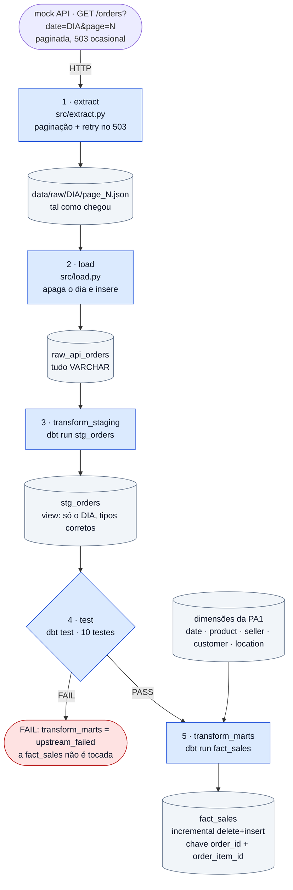

# NorthMart — Pipeline diário (PA2)

DAG `northmart_pa2` no Airflow: `@daily`, `max_active_runs=1`, um dia (`{{ ds }}`) por
execução. Retângulos = tarefas da DAG; cilindros = dados.

## Leitura do diagrama

| Passo | Tarefa | Entrada → saída | Porque não duplica ao repetir um dia |
|---|---|---|---|
| 1 | `extract` | API → `data/raw/<dia>/page_<n>.json` | reescreve os mesmos ficheiros |
| 2 | `load` | JSON → `raw_api_orders` | apaga o `extraction_date` antes de inserir (numa transação) |
| 3 | `transform_staging` | `raw_api_orders` → `stg_orders` | é uma view: não guarda dados |
| 4 | `test` | valida o `stg_orders` | só lê |
| 5 | `transform_marts` | `stg_orders` + dimensões → `fact_sales` | `delete+insert` pela chave `order_id` + `order_item_id` |

## Decisões

1. **Um dia por execução.** Cada execução recebe o seu dia (`{{ ds }}`), e o
   `stg_orders` só contém os itens desse dia: os testes validam exatamente o lote que
   vai entrar na fact.
2. **Os testes ficam entre o staging e o mart.** Se um teste falhar, a
   `transform_marts` não corre e a `fact_sales` fica como estava. Um dia em falta é
   visível; números errados na fact não seriam.
3. **Raw guardado sem alterações.** Os JSON ficam como a API os enviou e o
   `raw_api_orders` guarda tudo como texto. Assim, um lote corrompido é carregado,
   fica como prova e é rejeitado pelos testes, em vez de partir o load.
4. **Um dia de cada vez (`max_active_runs=1`).** O DuckDB só aceita um processo a
   escrever: dois dias em paralelo fariam falhar o segundo.
5. **As dimensões não mudam.** São as da PA1 e entram no dbt como `source`; o pipeline
   só alimenta a `fact_sales`.
