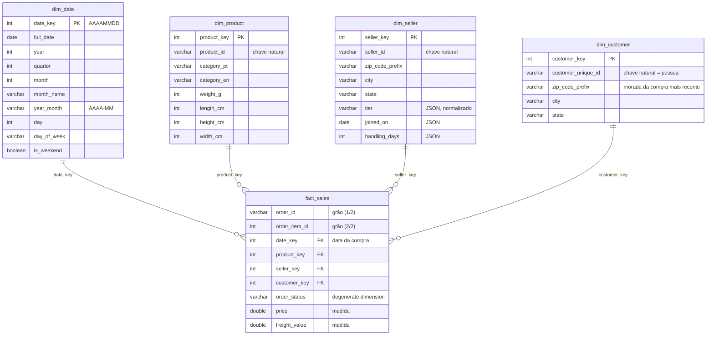

# NorthMart — Esquema em estrela (PA1)

## Grão

**Uma linha da `fact_sales` = um item de uma encomenda**, identificado pelo par
(`order_id`, `order_item_id`), que é único em `olist_order_items_dataset.csv`
(112 650 linhas, 112 650 pares distintos).

## Medidas

| Medida | Significado | Aditividade |
|---|---|---|
| `price` | preço do item | aditiva — soma-se a qualquer nível (encomenda, mês, categoria) |
| `freight_value` | custo de envio do item | aditiva |

Receita = `sum(price)`. O valor de uma encomenda obtém-se somando os seus itens.

## Dimensões

| Dimensão | Uma linha = | Origem |
|---|---|---|
| `dim_date` | um dia, de 2016-01-01 a 2018-12-31 | gerada (cobre todas as datas de compra e de entrega estimada) |
| `dim_product` | um produto | products `LEFT JOIN` category_name_translation |
| `dim_seller` | um vendedor | sellers (CSV) `LEFT JOIN` perfil JSON deduplicado |
| `dim_customer` | uma pessoa (`customer_unique_id`) | customers + orders (para escolher a morada mais recente) |

Ligação da fact ao cliente: `order_items → orders (customer_id) → customers (customer_unique_id) → dim_customer`.

## Decisões de modelação

1. **Cliente ao nível da pessoa, não do `customer_id` (decisão não óbvia).**
   Em `customers`, o `customer_id` é único mas é criado por encomenda (99 441, igual
   ao número de encomendas); a pessoa real é o `customer_unique_id` (96 096). Uma
   `dim_customer` por `customer_id` contaria 3 345 clientes a mais e tornaria
   impossível responder a "quantos clientes voltaram a comprar?". Por isso a
   dimensão tem uma linha por `customer_unique_id`; para as 256 pessoas com mais do
   que uma morada guarda-se a da compra mais recente.
2. **Pagamentos fora da fact.** `payment_value` está ao nível da encomenda; repeti-lo
   em cada item somaria o mesmo pagamento várias vezes (*double counting*).
3. **Categoria dentro da `dim_product`** (estrela, não floco de neve): a categoria é
   um atributo do produto; desnormalizar evita um JOIN extra em cada query.
4. **Dados de contacto dos vendedores excluídos.** `email` e `phone` não servem a
   análise de vendas e são dados pessoais (minimização de dados, RGPD).
5. **`dim_seller` parte do CSV.** Os 40 vendedores sem perfil ficam com `tier`,
   `joined_on` e `handling_days` a `NULL`; os 15 perfis sem vendedor no CSV ficam de
   fora (não têm vendas). Dos perfis repetidos fica a versão de `updated_at` mais
   recente.
